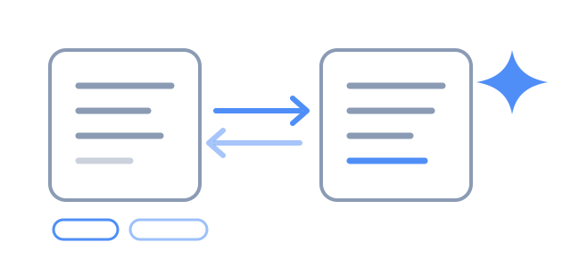
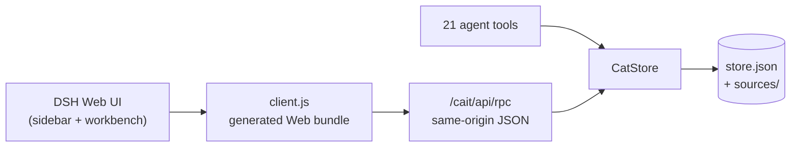

<p align="center">
  
</p>

<h1 align="center">dsh-ai-translation</h1>

<p align="center">
  <strong>Computer-aided translation, inside DeepSeek Harness.</strong><br/>
  Translation memory · glossary · segment editor · MT assistance · document tabs · Office / subtitle / localization formats<br/>
  <sub>A fork of <a href="https://github.com/JoviLecca/dsh-CAIT">CAIT</a> by Jovi Lecca — see <a href="#provenance-and-credits">Provenance and credits</a>.</sub>
</p>
<p align="center">
  <a href="README.zh-CN.md">简体中文</a> · <a href="README.ja.md">日本語</a> · <a href="README.md">English</a>
</p>


<p align="center">
  <a href="https://github.com/scottzhb-hue/dsh-ai-translation/releases"></a>
  
  
  
</p>

<p align="center">
  
</p>

**AI Translation** (the sidebar entry and the workbench header use this name; the upstream project is called CAIT) adds a CAT workbench to the DSH Web UI and Desktop. It opens from a
left-sidebar entry, keeps one shared store behind the workbench and twenty agent
tools, and covers the practical path from importing a source file to exporting a
translated document.

> **Tested with DSH `0.2.2-rc.1`.** AI Translation uses DSH's own model routes and
> credentials; it never asks for an API key. The internal fallback provider is
> still called `mock`, but the UI labels it **Glossary substitution (offline)**.

## Provenance and credits

This repository is a **modified fork of CAIT**, not an original project:

- **Upstream**: CAIT (`dsh-cait`) by **Jovi Lecca** — <https://github.com/JoviLecca/dsh-CAIT>, Apache-2.0.
- **This fork**: `@scottzhb-hue/dsh-ai-translation`, based on upstream `1.1.8`, with 26 documented enhancements in [OPTIMIZATIONS.md](OPTIMIZATIONS.md) — most notably a **project layer** (multi-file briefs, shared TM/glossaries, project-level analysis / quote / report / delivery / time tracking), a delivery and business workflow (pre-delivery checks, batch actions, quotes, post-editing metrics, local MT), and a reworked, task-oriented UI.
- **Naming**: this fork shows up in DSH as **AI Translation** (Chinese 「AI辅助翻译」, Japanese 「AI翻訳」) — sidebar entry, workbench header and in-app hints all use that name; `CAIT` / `dsh-cait` appear only as the upstream project name.
- **License and attribution**: still Apache-2.0. [LICENSE](LICENSE) is kept verbatim; [NOTICE](NOTICE) keeps the upstream notice and adds this fork's information. Any redistribution must keep both files.
- **Thanks**: the vast majority of this code base is upstream work — the CAT workbench, translation memory, glossary, multi-format import/export and the 21 agent tools are all Jovi Lecca's design and implementation.


## Why AI Translation

Upstream CAIT gives you a solid CAT core: translation memory, glossary, multi-format import/export and a segment editor. This fork keeps that core and adds the layer a working translator actually bills for — plus fixes for the things that made it hard to use day to day.

| | |
|---|---|
| **A project layer (new)** | One client, one batch, one brief, one set of term bases = one project: shared brief and shared TM/glossary (documents can override), project-level analysis / quote / report / delivery package, a project stopwatch, document reordering, «Unfiled» and a cross-project «All documents» table. |
| **Delivery and business (new)** | Pre-delivery checks + one-click ZIP (targets, bilingual copies, term list, QA, analysis, comments, delivery note), batch actions filtered by state and risk, quotes priced by match band, post-editing keep-ratios, and a local OpenAI-compatible MT endpoint. |
| **Translation core fixes** | Same-paragraph merges unlocked (Shift forces cross-paragraph), DOCX splits that stay inside one paragraph, no more broken sentences at `Aug.` / `St.`, no stray spaces when joining CJK, select-to-create-term, and automatic draft recovery for unconfirmed targets. |
| **AI and cost** | Brief guidance after creating a document, instruction confirmation before pre-translation, conversations distilled into the project brief, vision-wrapper routes skipped with the real error surfaced, and token usage/cost at official peak and off-peak prices. |
| **A UI organised by task** | Opens on a home screen (paste / import / resume / continue working); New and Import appear on the project page only; the editor keeps Usage · Pre-translate · Find & replace · Deliver · More; a render error boundary and library loading with timeout and retry. |
| **Native to DSH** | A real sidebar panel, a main workbench, DSH theme tokens, and the same store for humans and agents. No iframe, no separate app. |
| **TM that explains itself** | Multiple TM libraries, mounted-only lookup, 101% context (ICE) matches, exact / near-exact / high / medium / low fuzzy grades, and automatic write-back on confirm. |
| **Real format coverage** | TXT, Markdown, DOCX, EPUB, TMX, CSV, SRT/VTT, PO, XLIFF 1.2/2.0/SDLXLIFF, HTML, JSON, XLSX, PPTX, and RTF. Legacy `.doc` / `.xls` / `.ppt` are converted to OOXML first, using the Microsoft Office installed on the machine that runs DSH — with macros forcibly disabled. |
| **Agent-ready** | Twenty-one tools share the open document and store, so an agent can translate alongside you. |

## Quick start

1. Install it and open it from the **AI辅助翻译** row in the left sidebar.
2. Choose **New page**, then drop a source file or paste text.
3. Set the source and target languages.
4. Translate the current segment; the right panel shows TM matches, glossary hits,
   and an MT suggestion.
5. **Confirm & next** writes the pair to the default mounted TM.
6. Export target-only, bilingual, or a format-preserving document.

Typing in the editor is a draft and stays in memory. Confirming a segment (or an
explicit structural change) writes the snapshot. The open workbench polls the
Host revision every two seconds, so changes made by an agent appear without a
manual reload.

## Features

### Changed in 1.2.12

- **Narrower project column**: 236px → 208px (180px on narrow windows), leaving more room for the project detail.
- **Long project names wrap**: no more single-line ellipsis; the Unfiled tag stays top-aligned with the name.
- **“Add existing documents” is easier to spot**: 13px / weight 500 plus a plus icon, matching the “Documents” header.
- **One move interaction**: the project detail row uses the same in-place “Move ▾” menu as All documents; pick a target and the document moves immediately. The separate “Move to another project” dialog is gone.

### New in 1.2.11

- **Five project actions, one click away**: Save, Export delivery package, Project report ▾, Refresh analysis and Delete project (red, two-step) sit side by side; the “More” menu is gone.
- **Reports and exports pick their format in place**: both document tables show a “Format ▾” button in the report column (HTML / CSV download), and All documents gains its own Export column (DOCX / bilingual DOCX / bilingual XLSX / TMX / XLIFF / bilingual CSV).
- **Bilingual XLSX export**: Source / Target / Status columns, handy for row-by-row review and for comparing a client’s revision.
- **Table layout cleaned up**: headers and cells are left-aligned, 12px headers, percentage column widths (document column 22% / 18%), vertical rules and clearer row lines; long names are ellipsized with a tooltip.
- **Undoable delete, honest move menu**: confirming a delete now offers Cancel, and the move menu only lists projects the document is not in (Unfiled is compared by normalised id).
- **Resume where you left off**: the workbench reopens the project, document, library or align view you were on. A new “Always start from the welcome page” switch turns this off.
- **Downloads open in a new window**: when the desktop shell ignores the download attribute, the plugin panel no longer navigates away (fixes the blank screen after clicking a report in All documents).
### Changed in 1.2.11

- Project header now shows Save settings, Export delivery, Delete project and More side by side; “Project report” asks for HTML or CSV first.
- Downloads open in a new window, so a shell that ignores the download attribute no longer replaces the whole panel (this was the cause of the blank workbench after clicking a report icon).

### New in 1.2.9

- **One importer everywhere.** The welcome screen now uses the same drop zone as the project page: multi-select/multi-drop, the batch limits spelled out, and skipped files explained.
- **Batch ownership.** Importing several files from the welcome screen asks for the project once and files the whole batch there.
- **Progress with cancel.** Imports show a progress bar (n of m, current file) and can be cancelled; documents already imported are kept.
- **One set of entry points.** Once a project is selected, the top bar no longer repeats "New / Import" — the document card in the project detail owns them; "Add existing documents to this project" lists only documents that are not in the project yet.

### New in 1.2.8

- **Separate entry dialogs.** "New document" opens a text form with "Create document"; "Import file" opens a drop zone with "Import file". Neither shows the other's fields or tab.
- **Project-scoped creation.** Opening either entry from a project detail shows "Add to current project: <name>" and the document lands in that project directly — no ownership prompt, no project picker.
- **Ordered document list.** Each project keeps its own document order. Rows expose "Open", up/down and "Move" (one click to the project picker — Unfiled means removing it); reports sit in their own "Reports" column behind "⋯".
- **Batch import.** "Import file" accepts several files at once (up to 20 per batch, 8M characters total). Files are imported one by one with a "Importing 3/8…" progress label, and the dialog spells out the limits; oversized files are skipped with a reason.
- **Library detail as a dialog.** The entry detail opens in a dialog with a pinned Close button (Esc works), a sticky action row, and "Save and close"; the main pane stays two columns.

### Fixed in 1.2.7

- Opening the project view no longer crashes (React #310: the collapse-state hook sat after an early return in the project detail).
- The project detail test now covers the placeholder → detail transition.

### New in 1.2.6

- Project detail is now a header + a documents card + collapsible sections: the document list is the first and largest block, with a 14px title, a document count badge and the new/import actions on the right.
- Document rows use a "→ Open" button plus a "⋯" menu (HTML report / CSV report / move out) instead of four permanent icons.
- Analysis, reports, export and delete moved into a "More ▾" menu in the header; saving stays the single primary action.
- Project settings, brief, shared libraries and delivery/time are collapsed by default; the expanded/collapsed state is remembered in localStorage.

### New in 1.2.5

- Welcome screen rebuilt around one card: paste text / import a file are two tabs of the same form, with drag-and-drop on the import tab.
- "Resume last" is now a compact pill in the header that names the document or project it will reopen.
- Recent projects and open documents merged into one "Continue working" list (type chip, mini progress bar, relative time, up to 6 rows).
- The demo document link only appears for brand-new users.

### Changed in 1.2.4

- **Top bar follows context**: "New" and "Import" only appear in the project view; the library, alignment, home and editor views no longer repeat them.
- **Leaner editor toolbar**: the document view keeps Usage, Pre-translate, Find & replace, Deliver and a "More" menu, which holds Batch, Quote and Export.
- **Cleaner document strip**: the "new tab" button and the closed-document picker are gone; back-to-project, open document tabs and the progress readout remain.
### Fixed in 1.2.3

- **Opening a document no longer lands on an empty editor**: the view switches only after the document really opens.
- **Closing a document returns to its project**: closing the last tab goes back to the owning project.
- **Project detail renders first**: detail and analysis are decoupled, so a slow analysis cannot blank the panel.
- **Library list stops reloading forever**: the loader no longer depends on the global revision, times out after 8s and keeps the last rows.
- **Failures are readable**: load errors show a localized message with retry, including a 12s watchdog.
- **Analysis is manual**: a "Refresh analysis" button computes coverage and quote on demand.

### New in 1.2.2

- **Welcome page**: opening the panel lands on a start page — paste source text, import a file, load the demo document, or resume the last session. Recent projects and open documents are listed there, and the brand area in the top bar returns to it at any time.
- **Create inside a project**: the project detail now has "New document" and "Import file" actions that pre-assign the project and go straight to the editor.
- **Richer document tables**: the project document list gained an "Updated" column, and the all-documents table shows name / project / status / progress / segments / words / updated / actions with clickable rows.
- **Visible failures**: a render error now shows a copyable error panel instead of a blank panel, and the library page reports load failures with a retry button instead of spinning forever.

### New in 1.2.0

- **Projects.** Group documents under one project (client, due date, note). The
  plugin opens on the project view: the project list on the left, the selected
  project on the right with its documents, four-state status and progress,
  segments, words, tracked time, quote, and match analysis. Rename any project
  at any time.
- **Unfiled.** Documents without a project land in the built-in "Unfiled"
  project. After a document is created or imported, a dialog asks where it
  belongs: an existing project, a new one, or Unfiled.
- **All documents.** A secondary tab lists documents across projects, filterable
  by state (untranslated / incomplete / translated / done) and by name, with
  report and re-assignment actions in each row.
- **Shared brief, TM, and glossary.** A project carries the brief and the
  library bindings; its documents inherit them, a document can still override or
  opt out, and the resources panel marks what is inherited.
- **Project analysis, quote, and reports.** One pass computes match buckets for
  the whole project and turns them into a quote. Project and document reports
  come as printable HTML and CSV with status, progress, matches, QA, time, and
  the quote amount.
- **Project delivery.** Export every document plus a combined analysis CSV,
  glossary, QA CSV, notes, time CSV, and delivery note in a single ZIP.
- **Time tracking.** A project-level stopwatch (one project at a time, keeps
  running across restarts) plus manual entries.

### New in 1.1.7

- **DOCX depth.** Table cells, headers, footers, footnotes, and endnotes are
  imported as normal segments and written back to their original parts.
- **Localization catalogs.** Apple `.strings`/`.stringsdict`, Android
  `strings.xml`/plurals, `.resx`, `.arb`, nested YAML, and Java `.properties`
  round-trip with keys, comments, plural variants, block scalars, and inline
  tags intact.
- **Speaker notes and multi-sheet workbooks.** PowerPoint notes pages become
  separate units; every XLSX worksheet keeps its own name, order, and cell
  references. When the source workbook is retained, export patches the original
  cells so styles and merged ranges survive.
- **Subtitle timeline.** Merge adjacent cues, split at a time point, and shift
  all cues; overlapping cues show up as a high-risk QA finding.

### New in 1.1.6

- **Find and replace** across source/target with a preview, one-step apply, and
  undo; confirmed segments return to review when their target changes.
- **Command palette** (`Ctrl/Cmd+K`) and `Ctrl/Cmd+F` for find and replace.
- **Segment notes** for review comments, plus per-segment **draft undo/redo**.
- **Merge, split, and lock** text segments. Merge/split are limited to TXT and
  Markdown until Office paragraph mapping can be written back safely.
- **Term discovery for one-off names.** Quoted terms, capitalized names, and
  Chinese proper names that occur once are offered as candidates with evidence,
  type, and confidence; nothing is added to the glossary automatically.
- **AI review.** The QA tab can ask the configured DSH route for structured
  suggestions, jump to a segment, and fill a suggestion into the draft. Agents can
  call `cat_review`; neither path writes the document. Review follows the
  translation model by default, and Settings can give it a separate provider and
  model.

### New in 1.1.5

- Each document can **inherit the global TM/glossary mounts or bind its own
  libraries**, with a default write TM per document. Lookup, glossary hits, QA,
  pre-translation, and confirmations all honor that scope.
- **Word count and leverage analysis** reports segments, words, characters,
  duplicates, ICE/exact/fuzzy/new buckets, match rate, and leverage, with CSV and
  JSON download.
- Export a **bilingual review DOCX** (Source/Target/Status) for reviewers who do
  not use CAIT.
- Export and re-import an **XLIFF 1.2 review package**. Re-import matches by uid,
  XLIFF id, or a unique source, refuses source mismatches, and reports unmatched
  segments.
- **TM maintenance** previews and confirms merge, deduplicate, and prune actions.

### New in 1.1.4

- Each document can carry a **translation brief** — domain, audience, tone,
  notes, do-not-translate terms, and a style sample — which is injected into MT
  prompts and readable by agents through `cat_get_brief`.
- Pre-translation now sends **up to eight segments per request** with the brief
  and neighbouring source sentences, then falls back to one segment at a time
  for anything the model leaves out.
- Glossary entries can be **forbidden** (never use this rendering) or
  **preferred** (must use it when the source term appears), and the flags survive
  CSV/JSON/TBX export and CSV import.
- QA findings are graded **high / medium / low**, and the QA tab can jump to a
  finding, copy the source, clear the target, or insert the required term. A
  concordance tab searches every mounted TM for a word or phrase.
- A confirmed segment can be **unconfirmed** without deleting its text or its TM
  entry; editing a confirmed segment revokes the confirmation automatically.
- The segment rail can **clear all unconfirmed pre-translated targets** in one
  action. A confirmation dialog states the count and the MT/TM/auto breakdown,
  and confirms that confirmed segments, manual drafts, and saved TM entries are
  left untouched.

### Translation memory

- Multiple TM libraries with id, name, mount state, and a default write library.
- **Context match (ICE) at 101%.** Each confirmation records the two neighbouring
  source sentences. A later segment with the same neighbours scores 101% and is
  graded `context`; identical text with different neighbours stays at 100%. A key
  keeps up to 8 context variants and always keeps the context-free one.
- Exact, near-exact, and three fuzzy bands:
  - `near_exact` compares a key that ignores digits, punctuation, and whitespace;
    it does not depend on a score cutoff.
  - `high_fuzzy` is `>= 0.85`, `medium_fuzzy` is `0.75–0.85`, `low_fuzzy` is
    below `0.75` (above the configurable floor, default `0.70`).
- Fuzzy scoring is lexical: 72% character-bigram Dice + 28% token Jaccard.
  Latin text uses words; CJK text uses individual characters. There is no
  stemming, synonym, or semantic matching.
- Lookups only see mounted libraries. `cat_submit_translation` accepts an optional
  `targetTmId`; an unmounted target is rejected with `TM_NOT_MOUNTED`.
- `bootstrap().tm.entries` is a 40-entry preview of mounted entries;
  `bootstrap().tm.count` is the mounted count and `bootstrap().tm.total` is the
  all-library count. Use `cat_lookup_tm` or the library modal for full data.
- TMX 1.4 `<tu>/<tuv>/<seg>` import/export. Inline TMX placeholders are flattened
  to plain text with an explicit warning. Context travels as
  `<prop type="x-context">`, so a CAIT round-trip keeps 101% matches.

### Glossary

- Multiple glossary libraries with mount state and a default write library.
- Live source highlighting and click-to-insert term chips.
- CSV/TSV import, per-term notes, source-language filtering, and a
  `caseSensitive` flag honored by both the workbench and `cat_lookup_glossary`.
- Language codes are canonicalized (`EN` → `en`, `ZH_cn` → `zh-CN`).
- Entries can be edited or deleted in any library, mounted or not; mount state
  only decides what the workbench searches and writes.
- **Terminology mining**: *Mine terms from the document* in the glossary toolbar
  lists candidates with occurrence counts, sample wording from memory, and a
  marker when the term is already known. Counting finds and ranks the candidates
  (Latin n-grams, repeated CJK substrings filtered by boundary entropy); you
  confirm the wording and add them. A model-assisted shortlist that can include
  single-occurrence proper nouns is included since 1.1.6.

### Library workspace

`Documents` / `Libraries` / `Align` in the topbar switches between the translator
and the library manager. The library view needs no open document.

- One table for translation memory, one for glossaries, with paging
  (20/50/100/200, remembered), language filters, and a search that can be scoped
  to any combination of libraries.
- A side panel edits the selected entry in place, adds entries, and shows when a
  draft is unsaved.
- Translation memory exports to **TMX**; glossaries export to **TBX**, **CSV**, or
  **JSON**. Import and clear stay available in the same toolbar.
- The right panel's library button opens this workspace with the panel's search
  text already applied, so a lookup in the panel continues in the full list.

### Alignment

`Documents` / `Libraries` / `Align` — the third view builds a translation
memory from two finished files: the source document and its translation, as
separate files in any supported format and any pair of languages.

- Cross-language scoring: shared anchors (numbers, `{0}` placeholders, URLs,
  capitalised names), length normalised per language, and paragraph structure.
  Word overlap is deliberately not used, because it cannot compare two languages.
- Blocked dynamic programming pairs 1:1, 1:0, 0:1, 2:1 and 1:2; rows are graded
  high / to review / doubtful and start selected only when they are high.
- Each row can be merged with the next, split on line breaks, or removed before
  writing; the target library is chosen in the toolbar, and identical entries are
  skipped rather than duplicated.

### Workbench

- Paragraph/sentence segmentation with a per-segment target editor.
- Segment states: **pending** → **translated** → **confirmed**, with the origin of
  each translation (`tm`, `mt`, `agent`, `manual`) kept alongside the text. The
  rail filters by state and search covers source, target, and suggestions.
- **Segment paging**: the rail pages through the filtered segments with a page
  size of 20/50/100/200 and a box to jump straight to a segment number. Jumping
  clears the filter when the target segment would otherwise be hidden.
- **Pre-translate** fills the whole document from exact TM matches and machine
  translation in batches of up to eight segments, carrying the document brief
  and neighbouring source sentences, and falls back to one segment at a time
  when a batch response is partial. It shows `done/total` and can be stopped
  between blocks. Confirmed and already-translated segments are never overwritten.
- **Translation brief** lives beside the document: domain, audience, tone, notes,
  do-not-translate terms, and a style sample. It is editable from the segment
  header and used by both pre-translation and agent translation.
- **Stacked review**: source, the machine/agent baseline, and the editable target
  are laid out top to bottom, so each block gets the full pane width.
  **Confirm all** accepts every segment awaiting review after one confirmation
  dialog.
- Draft saving, confirm-and-next, previous/next navigation, and progress. The
  selected segment and the draft are persisted (debounced) so a restart resumes
  where you left off.
- **Repeated segments are mirrored**: confirming a sentence fills every other
  unconfirmed copy with the same source (`origin: auto`), editing a draft keeps
  them in sync, and *Fill repeated segments* does the whole document at once.
  Confirmed segments are never touched.
- Advisory QA markers in the rail and an export-time summary, graded **high /
  medium / low**: missing placeholders/tags, mismatched numbers, unused or
  forbidden glossary terms, empty targets, an untouched copy of the source,
  length drift, and one source with several translations. The QA tab lists
  findings and offers jump, copy-source, clear-target, and insert-term actions.
  Nothing is blocked and nothing is stored.
- **Undo confirmation.** A confirmed segment can be unconfirmed back to
  `translated`; its text and TM entry stay in place. Editing a confirmed segment
  revokes the confirmation automatically, and confirming it again updates the
  same TM entry.
- Document tabs; closing a tab does not delete the document.
- **Open existing document** reopens a closed document.
- Interface language switch in **Settings → Interface**: *Follow DSH language*
  (default), 简体中文, English, or 日本語. It applies to the workbench and the
  sidebar label right away, and changes only the CAIT UI — never the document's
  source or target language.
- The trash dialog beside the picker deletes one closed document or all closed
  documents; deletion is permanent and does not touch TM, glossary, or other
  documents.
- Re-importing identical content in the same format reuses the existing document
  instead of creating a duplicate. The fingerprint covers languages, source,
  format, and exchange metadata.
- Responsive density: the workbench measures its DSH panel and applies a damped
  `--cait-u` multiplier of 1×–1.45×. A 1600×900 panel renders at ~1.17× and a
  maximized 4K panel stops at 1.45×, which keeps large windows close to the host
  UI and leaves room for the three review columns.
- The workbench follows the host light/dark theme, including native controls
  (`color-scheme`), so selects, checkboxes, and scrollbars match the panel.

### Preprocessing

Imported source text passes through a preprocessing stage before segmentation:

- Collapse repeated spaces and tabs, trim indentation, and merge consecutive
  blank lines.
- Remove zero-width characters and stray control characters.
- Placeholder tokens (`{1}`, `{2}`, …), punctuation, casing, and paragraph order
  are left untouched, so XLIFF/HTML/EPUB inline markup still round-trips.
- The three steps are independently switchable in **Settings → Preprocessing** and
  are persisted with the other settings. They apply to new imports and
  `createDocument` calls; existing documents are not rewritten.

### MT assistance

CAIT does not own an endpoint or key. The selector is built from DSH:

- `ctx.llm.listProviders()` supplies registered provider routes.
- `ctx.loader.entries()` is consulted for `config.providers` when available.
- `ctx.llm.listModels(provider)` supplies model ids; CAIT selects the first model
  by default.
- `ctx.llm.stream({ provider, model, messages, temperature, purpose: 'cait-mt' })`
  performs the call; CAIT concatenates `text-delta` chunks. Batch pre-translation
  uses `purpose: 'cait-mt-batch'` and asks for a JSON array keyed by position;
  both paths include the document brief, the neighbouring source sentences, and
  the usable/forbidden glossary rules in the prompt.

If no usable route exists, the selected route disappears, or it has no models,
CAIT falls back to offline glossary substitution and says so in the UI and in the
`cat_suggest_mt` result. Stream failures are logged in the Host with
provider/model/code/status; the client receives only `MT_PROVIDER_FAILED`.

## Supported formats

| Format | Import | Export | Notes |
| --- | :---: | :---: | --- |
| TXT / Markdown | ✅ | ✅ | Paragraph and sentence segmentation |
| CSV | ✅ | ✅ | Comma, semicolon, tab, or pipe delimiter auto-detected; source/target column by header name or 1-based number; existing bilingual export |
| DOCX | ✅ | ✅ | Body paragraphs; table blocks are excluded from import. Export patches the original package, keeping styles, numbering, images, headers, tables, and layout. |
| EPUB | ✅ | ✅ | EPUB 3 spine order; XHTML text blocks with inline markup kept as tokens and patched back into the retained package. DRM-protected, fixed-layout, and scripted EPUBs are not supported. |
| TMX 1.4 | ✅ | ✅ | Common `<tu>/<tuv>/<seg>` subset; inline markup flattened with warning; context kept in `<prop type="x-context">` |
| SRT / WebVTT | ✅ | ✅ | One cue per segment, timings/settings/identifier retained; semantic tags kept; invalid ranges rejected |
| PO | ✅ | ✅ | Contexts, plural forms, translator comments, obsolete `#~` entries |
| XLIFF 1.2 | ✅ | ✅ | Inline tags become `{n}` tokens; missing tokens block confirmation |
| XLIFF 2.0 | ✅ | ✅ | Basic `<unit><segment><source>/<target>` subset |
| SDLXLIFF | ✅ | ✅ | Basic XLIFF 1.2 path; SDL-specific extensions are not round-tripped |
| HTML | ✅ | ✅ | Text blocks and inline tags preserved; document CSS/layout is not rebuilt |
| JSON | ✅ | ✅ | String-path subset; object/array structure preserved via a template; keys and numbers are not translated |
| XLSX | ✅ | ✅ | All worksheets; source/target columns (or headers); source-preserving patch keeps styles, merges, and other sheets; formulas are skipped |
| PPTX | ✅ | ✅ | Source-preserving export; requires the imported `.pptx` package. Body text and speaker notes; charts/SmartArt not imported. |
| RTF | ✅ | ✅ | Basic paragraphs, `\uN`, `\'hh`, control words; original styling not round-tripped |

\* PPTX export fails with `PPTX_SOURCE_REQUIRED` when the retained source package
is missing rather than silently producing an unformatted deck.

Exchange metadata (subtitle timings, PO contexts/plurals/comments, XLIFF ids and
inline token maps, JSON paths/templates, XLSX rows, PPTX slide/paragraph positions,
EPUB spine hrefs and block indexes) is stored on the document/segments and persists
in the snapshot.

### PDF is not supported

CAIT does not import PDF, and future releases will not add PDF support. PDF is a
fixed-layout print format: it has no logical paragraphs, reading order, or inline
markup. Text extracted from it is fragmented across drawing operations, loses
headings, tables, and inline emphasis, and produces segments that are poor input
for translation memory and MT — in other words, PDF is extremely unsuitable for
AI-related work.

To translate PDF content, convert it to a supported format first, for example:

```sh
pandoc input.pdf -t docx -o output.docx   # or -t html, -t markdown
```

Adobe Acrobat's **Export to Word/HTML**, LibreOffice, or any other converter that
produces DOCX, HTML, EPUB, or plain text works too. Scanned PDFs need OCR before
conversion; CAIT has no image OCR stage.

## Install

CAIT installs as a DSH bundle; the published package name is `@scottzhb-hue/dsh-ai-translation` and the
plugin itself shows up as **AI辅助翻译** in the left sidebar. The in-app plugin
manager owns the `desktop` profile, so use it rather than editing the profile's
`package.json`.

> `plugin_manager …` is a **DSH tool call** — ask the agent to run it, or paste the same spec into the in-app plugin manager. It is not a shell command.

### From npm

In DSH Desktop (or any profile with the `plugin_manager` tool):

GitHub Packages needs `@scottzhb-hue:registry=https://npm.pkg.github.com` in `.npmrc` plus a token that can `read:packages`; installing straight from this repository (the `github:` spec below) needs no registry auth.

```text
plugin_manager install_bundle target: @scottzhb-hue/dsh-ai-translation
```

Pin a release with `@scottzhb-hue/dsh-ai-translation@1.1.1`, or ask for the newest one with
`@scottzhb-hue/dsh-ai-translation@latest`. The manager resolves the registry package, applies the bundle
patch, and activates the plugin — no hand-written profile rows.

One-time registry setup (PowerShell) — run it once, then the command above works:

```powershell
# Register GitHub Packages in the user-level .npmrc (token needs read:packages)
$secure = Read-Host "GitHub token (read:packages)" -AsSecureString
$token  = [Runtime.InteropServices.Marshal]::PtrToStringBSTR(
            [Runtime.InteropServices.Marshal]::SecureStringToBSTR($secure))
$npmrc  = Join-Path $env:USERPROFILE ".npmrc"
Add-Content -LiteralPath $npmrc -Value "@scottzhb-hue:registry=https://npm.pkg.github.com"
Add-Content -LiteralPath $npmrc -Value "//npm.pkg.github.com/:_authToken=$token"

npm.cmd view "@scottzhb-hue/dsh-ai-translation" version --registry=https://npm.pkg.github.com
```

Once `npm view` prints a version, go back to DSH and run the `plugin_manager install_bundle …` call. Treat
the token like a password: keep it in `.npmrc` only and give it an expiry date.

With a CLI-managed profile:

```sh
dsh plugin --profile web add @scottzhb-hue/dsh-ai-translation
```

Replace `web` with your profile name, and restart `dsh web` if your host
requires it.

### From this repository

GitHub:

```text
plugin_manager install_bundle target: github:scottzhb-hue/dsh-ai-translation
```

Local checkout:

```text
plugin_manager install_bundle target: /absolute/path/to/dsh-ai-translation
```

Then reload DSH. The **AI辅助翻译** entry appears in the left sidebar.

### From source

```sh
git clone <this-repository> dsh-ai-translation
cd dsh-ai-translation
npm run build:client
```

For a local `--patch` overlay, add a row pointing at this directory:

```yaml
# _dev/cait.patch.yml
- insert:
    - id: cait-dev
      name: 'C:\absolute\path\to\dsh-ai-translation'
```

```powershell
dsh web --patch C:\absolute\path\to\dsh-ai-translation\_dev\cait.patch.yml
```

`--patch` is a launcher option; place it after the app name (`web`) and before
any app arguments. Use either the overlay or the installed bundle in a profile,
not both.

## Configuration

| Option | Default | Meaning |
| --- | --- | --- |
| `dataDir` | `""` | Directory for `store.json` and `sources/`. Empty means `$DSH_HOME/cait`. Absolute, relative, and `~/...` paths are accepted. |

```yaml
- id: dsh-ai-translation
  name: "@scottzhb-hue/dsh-ai-translation"
  config:
    dataDir: 'D:\CAT\cait-data'
```

The snapshot stores documents, open tabs, TM, glossary, libraries, mounts, and
non-secret settings. Imported DOCX/PPTX/EPUB source packages live in `sources/`.

In-app settings (**Settings**) live in the snapshot rather than in the YAML
above: source/target language, fuzzy threshold, TM result limit, MT
route/model/temperature, and the interface language (`uiLang`: `auto` | `zh` |
`en` | `ja`, default `auto` = follow the DSH locale).
Segment confirmations use a strict write: if the snapshot cannot be written, the
confirm fails with `PERSISTENCE_FAILED` (503) and rolls back the in-memory
confirmation. Other structural edits remain best-effort and surface
`bootstrap().storage.error` in the workbench banner.

If the snapshot is corrupt or has an unknown version, CAIT logs a warning, moves
it to `store.json.corrupt-<timestamp>`, and starts empty instead of failing
activation. Version-1 and version-2 snapshots are migrated to version 3 with
default TM and glossary libraries; a version-2 draft that had text but was never
confirmed becomes `translated` with `origin: manual`.

## Agent tools

| Tool | Purpose |
| --- | --- |
| `cat_get_segment` | Current segment with TM matches and glossary hits |
| `cat_submit_translation` | Confirm a target, write to a mounted TM (optional `targetTmId`), advance |
| `cat_lookup_tm` | Graded TM lookup across mounted libraries |
| `cat_lookup_glossary` | Query mounted glossaries; honors `caseSensitive` |
| `cat_list_documents` | List documents and progress |
| `cat_switch_document` | Select the active document |
| `cat_suggest_mt` | MT via the selected DSH route, or the explicit offline fallback |
| `cat_pre_translate` | Fill one block from TM + MT, skipping confirmed/translated segments; returns `next` |
| `cat_get_segments` | Bounded segment window with status, origin, and suggestions |
| `cat_confirm_segments` | Confirm a list of indices, a window, or everything awaiting review |
| `cat_propose_translation` | Leave a suggestion plus a reason without touching the confirmed target |
| `cat_align` | Align two texts and report high / to-review / doubtful pairs |
| `cat_consistency_report` | Group repeated sources that carry different translations |
| `cat_term_candidates` | Mining shortlist, including one-off proper names, with type/confidence and evidence |
| `cat_get_brief` | Read the document brief before translating |
| `cat_set_brief` | Update brief fields, or clear the whole brief |
| `cat_get_context` | Brief, current segment, previous/next sources, and paragraph around a segment |
| `cat_unconfirm_segment` | Revoke a confirmation without deleting the text or TM entry |
| `cat_concordance` | Search every mounted TM for a word or phrase in source or target |
| `cat_add_terms` | Add accepted terminology to a library in one batch |
| `cat_review` | Ask the model for structured review suggestions; never writes the document |

An agent can therefore draft a whole document without clicking in the UI:
`cat_pre_translate` with `from: next` until `next` is `null`, then
`cat_get_segments` to review, then `cat_confirm_segments` to accept. For
terminology it reads `cat_term_candidates`, judges the shortlist, and writes the
result with `cat_add_terms`.

The workbench and tools share one `CatStore`, so an agent can translate the same
document the user has open.

## Architecture



- **Host** (`index.js`, `lib/`) owns the store, persistence, import/export, tools,
  and the private API.
- **Client** (`client/`) is plain React loaded through DSH's module loader and
  rendered into `sidebar.panellist` and `main`. It styles only with
  `--dsw-alias-*` tokens.
- `client.js` is generated; edit `client/*.js` and run `npm run build:client`.

<details>
<summary><strong>Project layout</strong></summary>

```text
cait/
├─ index.js                 # Host half: store + tools + private API
├─ client.js                # generated Web bundle (do not edit)
├─ client/                  # Web half sources
│  ├─ index.js              # slot + locale wiring
│  ├─ helpers.js            # pure helpers, no imports
│  ├─ rpc.js                # fetch wrapper + transport errors
│  ├─ errors.js             # error code → message lookup
│  ├─ react.js              # the only module that imports React
│  ├─ styles.js             # CSS + px→var(--cait-u) scaling
│  ├─ locales.js            # ZH/EN/JA dictionaries (621 keys each)
│  ├─ components/           # one module per surface
│  └─ workbench/            # controller.js (state) + workbench.js (view)
├─ lib/                     # Host modules; the map is docs/ARCHITECTURE.md §5
│  ├─ store.js              # CatStore facade, applies store-mixins.js
│  ├─ store-mixins.js       # single registry of store modules
│  ├─ api.js                # private RPC + the only mutation list
│  ├─ tools.js              # 21 agent tools
│  └─ …                     # documents, segments, libraries, formats, persistence
├─ scripts/                 # build, contract checks, test runner, bench
├─ locale/{en,zh,ja}.json   # package metadata strings only
├─ docs/                    # ARCHITECTURE.md, NEXT-ROUND.md
└─ _dev/                    # test suites + fixtures
```

The full module map, dependency direction, and the rules for adding a store
method, an RPC handler, a format, or an error code live in
[`docs/ARCHITECTURE.md`](docs/ARCHITECTURE.md). Keep this sketch short so it
cannot rot.

</details>

## Development

Requires Node.js 22+ and DSH `0.2.x`. Tested with DSH `0.2.2-rc.1` and Node
`26.7.0`.

```sh
npm install        # once
npm run check      # everything CI runs: lint, format, contracts, tests
npm test           # just the 51 suites in _dev/
```

`npm run check` is the gate. It runs, in order:

| Step | What it proves |
| --- | --- |
| `lint` | ESLint over `lib/`, `index.js`, `scripts/`, `_dev/`, `client/` |
| `format:check` | Prettier agrees with the tree |
| `check:locales` | ZH/EN/JA have the same 621 keys and the same `{placeholders}` |
| `check:errors` | every error code raised in `lib/` resolves to a message |
| `check:store` | every store mixin is registered and no name is shadowed |
| `check:formats` | every export format and import extension is wired and offered |
| `check:shared` | client and server agree on shared constants |
| `check:api` | every RPC handler exists on the store and every client call exists |
| `check:client` | `client.js` on disk equals what `client/` builds |
| `test` | 51 suites in `_dev/`, run one process at a time |

`npm run bench` measures the scale paths (`--segments 20000 --tm 10000` by
default); use it before changing anything the numbers depend on.

The import/export fixtures are `_dev/sample.docx`, `_dev/sample-table.docx`, and
`_dev/sample-format.docx`; regenerate them with the matching
`python _dev/make-*.py` scripts.

### Releasing

`npm publish` runs `prepublishOnly`, which rebuilds `client.js` from `client/`
and then runs the full `npm run check`, so a release cannot ship a stale bundle
or a failing contract. Publishing from the repository root:

```sh
npm publish
```

`.github/workflows/publish.yml` does the same from CI on a published GitHub
release, using npm Trusted Publishing (OIDC) instead of a stored token, and it
refuses to publish when the release tag does not match `package.json`.

The very first release has to be published locally, because a trusted publisher
can only be configured for a package that already exists:

```sh
npm login
npm publish
```

Afterwards open the package on npmjs.com, go to
**Settings → Trusted publishing**, and add the repository `JoviLecca/dsh-CAIT`
with the workflow file `publish.yml`. Later releases can then be published from
GitHub with a release.

## Security model

- The Host API is mounted at `/cait/api`, restricted to same-origin/trusted
  requests by `ctx.connection.requestRejection`.
- RPC bodies are JSON, capped at 32 MB, and return `413 BODY_TOO_LARGE` beyond
  that.
- `clearTM` / `clearGlossary` require `params.confirm === true` in addition to
  the browser trust check; the UI asks before sending it.
- CAIT never receives, stores, or returns an API key. DSH credentials stay inside
  the selected provider adapter.
- Persistence is one snapshot with last-write-wins semantics; it is not a
  multi-user journal.

## Known limits and roadmap

- No PDF import; PDF is intentionally out of scope (see
  [PDF is not supported](#pdf-is-not-supported)). No image OCR yet.
- EPUB import follows the spine and body XHTML text blocks; DRM-protected,
  fixed-layout, scripted, and MathML-heavy books are not supported.
- DOCX import covers body, tables, headers, footers, footnotes, and endnotes;
  fields, alt text, and tracked deletions still stay in the source language.
- Mixed-run DOCX/PPTX paragraphs inherit the first run's formatting.
- PPTX import covers body text and speaker notes, not charts or SmartArt.
- XLSX export needs a target column to patch; formula cells are skipped, and a
  workbook imported before 1.1.7 has no retained source to patch.
- Nested YAML supports mappings, sequences, scalars, block scalars, and
  comments; anchors, aliases, merge keys, and flow collections are rejected
  with `LOCALIZATION_YAML_UNSUPPORTED`.
- HTML/RTF export does not round-trip original styling; JSON translates string
  values only.
- TM matching is lexical, not semantic; no stemming, synonyms, or embeddings.
- One translation per source text per context: a repeated sentence keeps a
  separate variant for each surrounding pair, capped at 8 variants per key, and
  reuses the generic entry when the neighbours differ.
- TM context is the two neighbouring source sentences only; the document brief
  and project metadata are used by MT prompts but are not part of TM scoring.
- TBX and JSON glossary exports are one-way; only TMX and CSV import back.
- The workbench UI ships in Chinese, English, and Japanese, switchable in
  Settings; this README ships in English, Simplified Chinese, and Japanese, and
  the English version is the source of truth.

Shipped since 1.1.5: per-document TM/glossary binding, word-count and leverage
analysis, bilingual DOCX review output, and an XLIFF review package. 1.1.6 added
find/replace, segment merge/split/lock, comments, local undo, and an optional LLM
review pass. 1.1.7 added DOCX tables/headers/footnotes, nested localization
catalogs, source-preserving multi-sheet XLSX, speaker notes, and subtitle
timeline controls. Next candidates: Office paragraph mapping for merge/split
and a subtitle waveform.

## Changelog and versioning

See [CHANGELOG.md](CHANGELOG.md). `v1.0.0` was the first public release;
`v1.0.1` adds the Japanese UI and the in-app interface language switch,
`v1.0.2` makes *Follow DSH language* honour the DSH locale, `v1.0.3`
publishes the package to npm, `v1.0.4` moves later releases to the
provenance-publishing workflow, `v1.0.5` adds EPUB, import preprocessing,
and the PDF policy, `v1.1.0` adds agent-driven pre-translation, the
three-state segment model, stacked review, and advisory QA, `v1.1.1` adds
the library workspace with TMX/TBX/CSV/JSON export, segment paging, and the
panel-to-library jump, `v1.1.2` adds context-aware memory with 101% (ICE)
matches, `v1.1.3` adds two-file alignment, automatic propagation of repeated
segments, terminology mining, and the proposal primitive agents use, and
`v1.1.4` adds the document brief, context-aware batch pre-translation,
forbidden/preferred terminology, risk-graded QA with one-click fixes,
concordance, and undo confirmation, and `v1.1.5` adds per-document TM/glossary
scopes, word-count and leverage analysis, bilingual DOCX and XLIFF review
packages, and TM maintenance.
The project
was developed as `0.1.0` and renumbered for the GitHub release.

> **License:** Apache License 2.0 — see [LICENSE](LICENSE). Redistributions must
> retain the attribution in [NOTICE](NOTICE).
